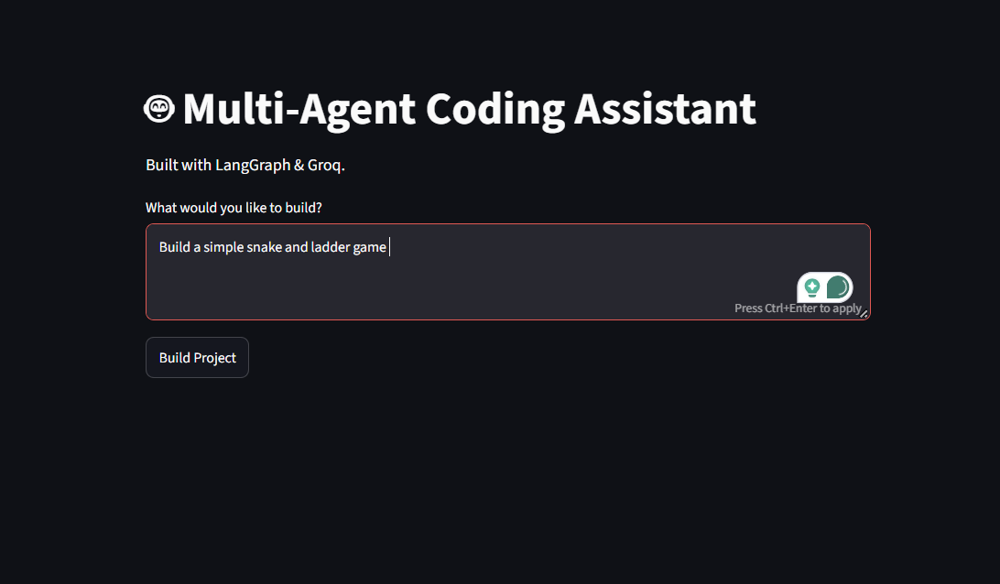
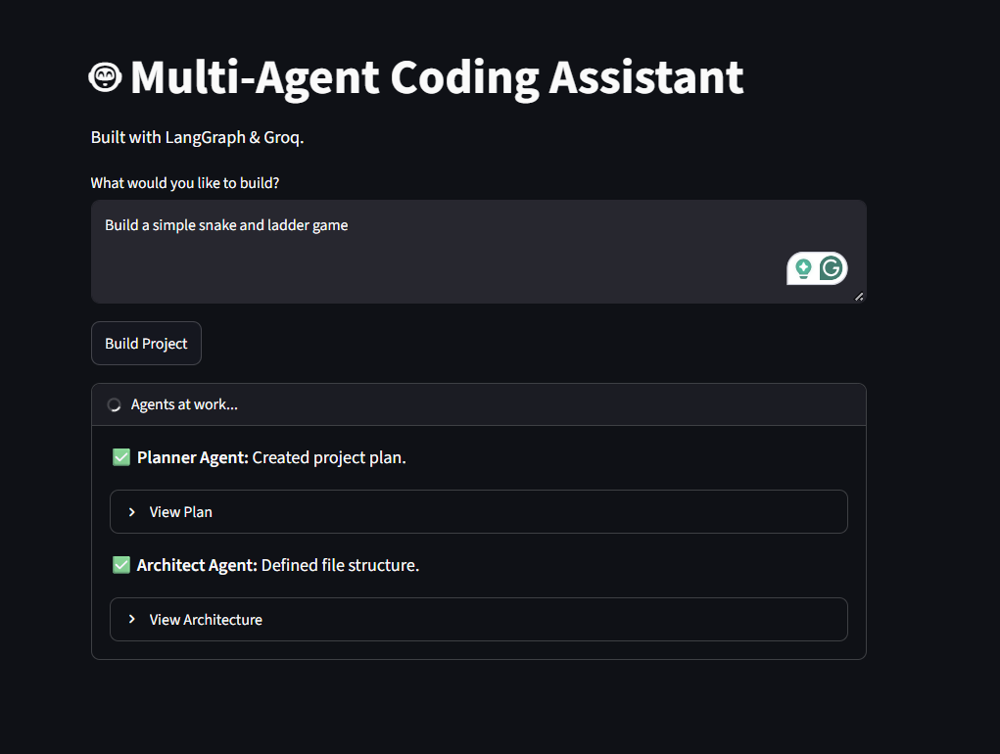
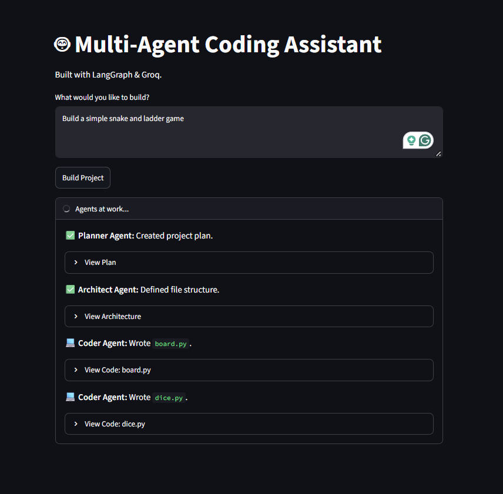
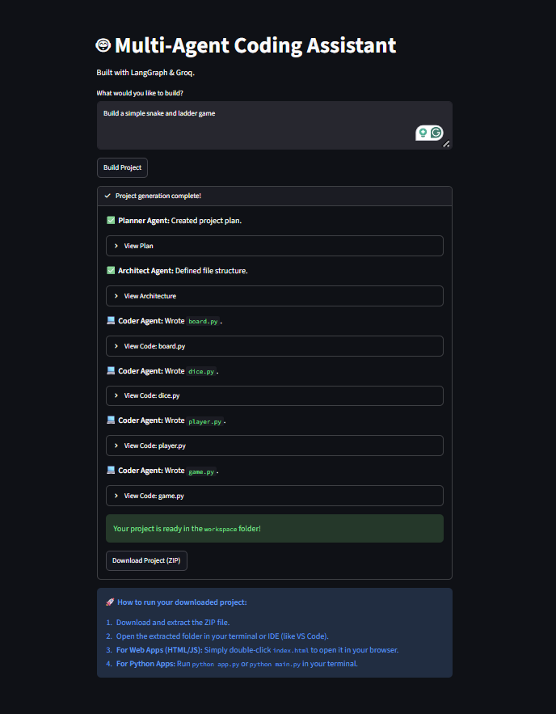
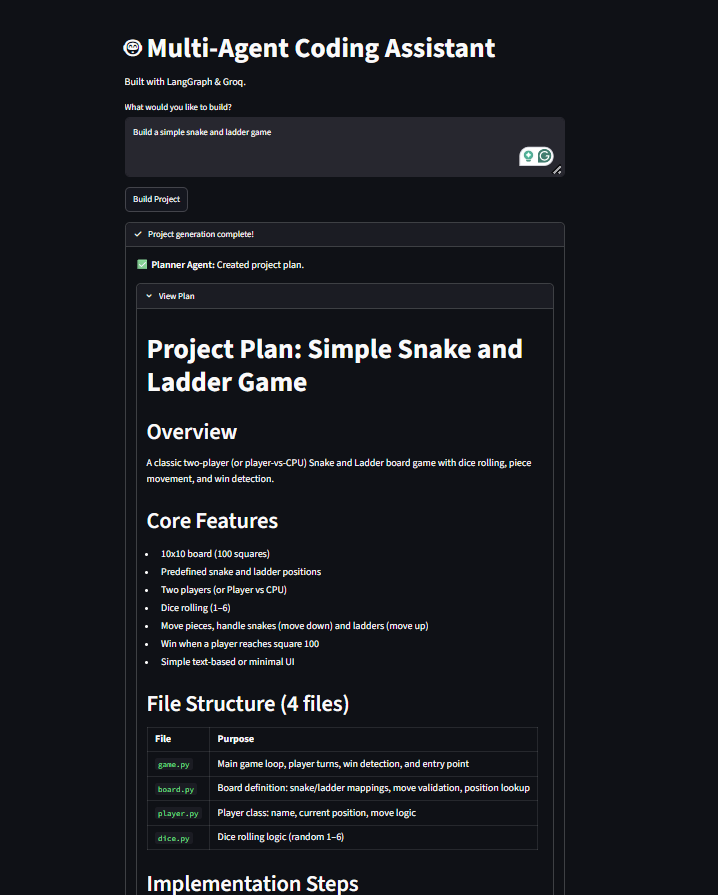
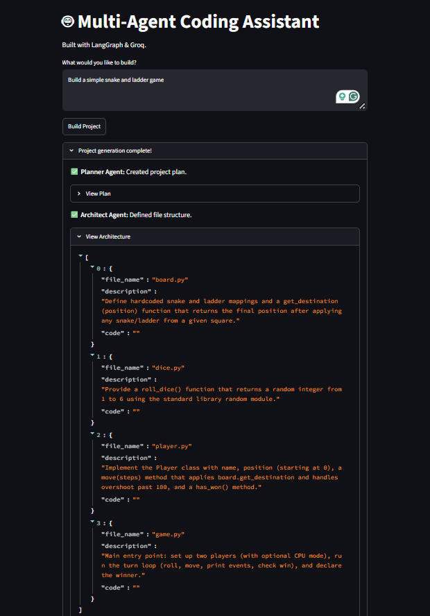
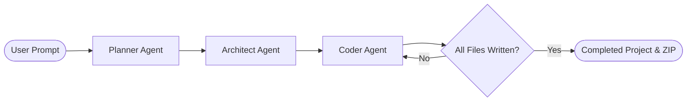

# 🤖 Multi-Agent Coding Assistant

An AI-powered software engineering team built with **LangGraph**, **Groq**, and **Streamlit**.

This application takes a natural language request (e.g., *"Build a simple snake and ladder game"*) and coordinates a multi-agent system to plan the architecture, determine the optimal file structure, and generate complete code file-by-file into an executable project.

---

## 📸 Screenshots & Walkthrough

### 1. Natural Language Prompt
Enter your project idea in plain English and launch the agent team with a single click.



---

### 2. Live Multi-Agent Execution
Watch the Planner and Architect agents coordinate in real time to establish requirements and build the file manifest.



---

### 3. File-by-File Code Generation
The Coder agent iterates through the architecture, writing clean, modular code for every file with automatic rate-limit pacing and retry protection.



---

### 4. Project Ready & Instant ZIP Download
Once coding is complete, the project is saved to the `workspace/` directory and packaged into a one-click downloadable ZIP with execution instructions.



---

### 5. Inspectable Plans & Architecture
Explore the reasoning behind every design decision with built-in expanders for the project plan and structured JSON architecture:

| Project Plan Details | Structured Architecture Schema |
| :---: | :---: |
|  |  |

---

## 🏗️ How It Works (Agent Workflow)



- **🧠 Planner Agent:** Analyzes the prompt, determines the optimal tech stack, and drafts a structured, step-by-step software plan.
- **📐 Architect Agent:** Uses Pydantic structured output to translate the plan into a clean manifest of 3–6 modular, runnable files.
- **💻 Coder Agent:** Iterates file-by-file in a LangGraph loop, writing pure, production-ready code with rate-limit backoff protection.

---

## 🛠️ Tech Stack

- **Framework:** [LangGraph](https://github.com/langchain-ai/langgraph) / LangChain
- **LLM Provider:** [Groq](https://groq.com/) (Fast Inference Engine)
- **Frontend / UI:** [Streamlit](https://streamlit.io/)
- **Validation:** Pydantic v2
- **Environment:** Python 3.10+

---

## 🚀 Getting Started

### 1. Clone the repository
```bash
git clone https://github.com/bhaktideshmukh/Multi-Agent-Coding-Assistant.git
cd Multi-Agent-Coding-Assistant
```

### 2. Set up the Environment
Create and activate a virtual environment, then install dependencies:
```bash
python -m venv venv

# On Windows:
.\venv\Scripts\activate

# On Mac/Linux:
source venv/bin/activate

pip install -r requirements.txt
```

### 3. Add your Groq API Key
Create a `.env` file in the root directory:
```env
GROQ_API_KEY=your_groq_api_key_here
```
> Obtain a free API key at [console.groq.com](https://console.groq.com/).

### 4. Run the Application
Launch the Streamlit interface:
```bash
streamlit run main.py
```
Open [http://localhost:8501](http://localhost:8501) in your browser.

---

## 📦 Running Generated Projects

Downloaded projects are completely self-contained in the `workspace/` folder:
- **Web Apps (HTML/CSS/JS):** Double-click `index.html` to open in any web browser.
- **Python Apps:** Run `python main.py` or `python app.py` from the project directory.